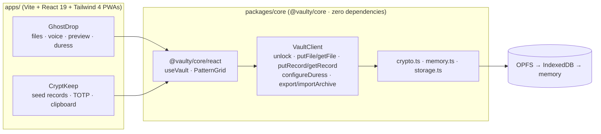

# Design — Showcase apps (`GhostDrop` + `CryptKeep`)

Traceability: `S*`, `G*`, `C*`, `I*`, `P*` refer to `requirements.md`; `core §*` / `core R*` refer to `.kiro/specs/vaulty-core/`.

## 1. Thesis

Two products with different data shapes, threat models and visual languages — both are **thin UI shells** over the
same SDK. All cryptography, key management, plausible deniability, duress, storage and archive logic is
`@vaulty/core`. Anything the apps add is presentation, file/clipboard/microphone plumbing, and RFC 6238 (which is an
authenticator feature, not a vault feature).



## 2. Reuse matrix — which SDK call powers which feature

| Capability | GhostDrop | CryptKeep | `@vaulty/core` API (no app-side logic) |
|---|:--:|:--:|---|
| Pattern entry UI | ✓ (emerald/slate) | ✓ (amber/carbon) | `<PatternGrid nodeColor activeColor lineColor size ariaLabel onComplete onError />` |
| Unlock, silent vault creation, no wrong-pattern errors | ✓ | ✓ | `useVault().unlock()` → `VaultClient.unlock()` (core R7) |
| One-time 9-word phrase | ✓ | ✓ | `UnlockResult.recoveryPhrase` when `created` |
| Namespace fingerprint badge | ✓ | ✓ | `useVault().namespaceId` (PBKDF2-derived id, core §3.1) |
| Encrypted binary files, voice notes | ✓ | — | `putFile`, `getFile`, `deleteFile`, `listEntries` (`vault.entries`) |
| Typed JSON records | — | ✓ | `putRecord<SeedEntry>`, `putRecord<TotpEntry>`, `getRecord<T>` |
| BIP-39 word validation | — | ✓ | `WORDLIST` export |
| Duress trigger + purge | ✓ | — | `client.configureDuress()`; wipe happens inside `unlock()` (core R8) |
| `.vault` export / restore | ✓ | ✓ | `exportArchive()`, `importArchive(bundle, patternOrPhrase, {newPattern})` |
| Auto-lock (idle, hidden tab, pagehide) | ✓ 120 s | ✓ 90 s | `useVault({ idleTimeoutMs })` → `SessionGuard` (core R6) |
| Storage backend selection | ✓ | ✓ | `createBestStorageAdapter()` |
| Key zeroing on lock | ✓ | ✓ | `SecureBuffer.wipe()` via `lock()` |

What the apps own, and why it is not "crypto/storage duplication":

| App-side code | Purpose |
|---|---|
| `lib/recorder.ts` (GhostDrop) | `getUserMedia`/`MediaRecorder` plumbing and **zero-filling** of the audio buffers it creates. No encryption. |
| `lib/files.ts` | Blob → `Uint8Array`, download helper. |
| `components/EvidenceList.tsx` `Previewer` | `Blob` + `URL.createObjectURL` lifecycle (create, revoke, zero the decrypted array). |
| `lib/totp.ts` (CryptKeep) | RFC 6238/4226 over native `crypto.subtle` **HMAC `sign` only**. Not part of vault security; required to interoperate with every authenticator. |
| `lib/clipboard.ts` (CryptKeep) | Copy + 15 s overwrite countdown. |
| `lib/hooks.ts` `useRecords` | Loads `getRecord<T>` for a tag and **drops the list on lock**. |
| `lib/adapter.ts` | Singleton around `createBestStorageAdapter()` (StrictMode-safe). |

`tests/architecture.test.ts` in each app proves the boundary (S1.6): it scans `src/` and fails on any Web Crypto use
(outside `lib/totp.ts`, which may only use `HMAC`/`sign`), web storage, browser databases, network I/O, `console`,
`Math.random`, unexpected imports, or extra runtime dependencies — and asserts each SDK capability is actually used.

## 3. State & lifecycle

```
App
 ├─ useVault(options)            ← only source of truth for lock state + decrypted metadata
 ├─ LockScreen  (locked)         PatternGrid → unlock(pattern)
 │    └─ Restore / Recover modal importArchive(bytes, pattern | phrase, { newPattern })
 ├─ VaultScreen (unlocked)       panels read vault.entries / records
 └─ RecoveryModal                phrase held in React state ONLY until confirmed or lock
```

* `App` clears the recovery phrase in an effect on `isUnlocked → false` (S2.6), and CryptKeep also calls
  `ClipboardGuard.clearNow()` there (C2.3).
* `useRecords` returns `[]` the instant the signature becomes `null` (locked) (S2.7).
* GhostDrop bumps an `epoch` key after a duress result so every screen remounts with fresh local state (G4.2).
* Unmounting an owned `useVault` client locks it (core hook behaviour).

## 4. Feature designs

### 4.1 GhostDrop

* **Intake (G1)** — `readBlobBytes(file)` → `putFile(bytes, {name, mimeType, tags:['evidence']})` → `bytes.fill(0)` in `finally`.
  Whole-file, in-memory encryption (the SDK API takes a `Uint8Array`); capped at 512 MiB. Streaming/chunked AEAD would be a core feature.
* **Voice notes (G2)** — `VoiceNoteRecorder` collects `Blob` chunks; `sealClip()` reads each into a `Uint8Array`, concatenates,
  hands the single array to the sink (`putFile`), then zero-fills parts and the combined array in `finally`.
  Tested with fakes (`tests/lib.test.ts`) and with a real fake-device microphone in Chrome (`e2e/browser-check.mjs`).
* **Previewer (G3)** — `getFile()` → `new Blob([data])` (copies) → `data.fill(0)` → `createObjectURL`. Cleanup revokes on close,
  unmount and `visibilitychange → hidden`; default policy locks the vault on close. SVG is excluded.
* **Duress (G4)** — `PatternSetter` (draw twice) → `client.configureDuress(pattern)`. The lock-screen path needs no app code:
  `unlock()` itself wipes and returns `duress_triggered`, and the app simply remounts a clean lock screen.
* **Archives (G5)** — thin wrappers over `exportArchive`/`importArchive`; `RestoreModal` supports pattern or phrase (+ new pattern).

### 4.2 CryptKeep

* **Seeds (C1)** — form → `validateSeed` (count + `WORDLIST`) → `putRecord<SeedEntry>`. Cards render `•••••` placeholders; the real
  word enters the DOM only while revealed (10 s timer). Words exist in React memory while unlocked (decrypted record list) and are dropped on lock.
* **Clipboard (C2)** — `ClipboardGuard`: `writeText(secret)`, 1 s ticks from 15, then `writeText('')`. Verified with fake timers (exactly 15 s)
  and with the real system clipboard in Chrome (cleared at 15.1 s).
* **TOTP (C3)** — `useNow(clock)` ticks every 250 ms; each `TotpCard` recomputes its code in an effect keyed on the time step; the ring is an
  SVG circle whose `stroke-dashoffset` follows `remaining / period`. `clock` is injectable so tests pin RFC timestamps.
* **Recovery (C4)** — `RestoreModal initialMethod="phrase"`: file + phrase + `PatternSetter` → `importArchive(bytes, phrase, {newPattern})`.

## 5. PWA, CSP and offline

* `public/manifest.webmanifest`, 192/512 PNG icons (generated by `scripts/gen-icons.mjs`, dependency-free), `base: './'` so the apps
  work from a sub-path (e.g. GitHub Pages).
* `public/sw.js`: stale-while-revalidate for same-origin GETs, navigation fallback to the cached `index.html`; registered only in production builds.
* Production `index.html` receives a CSP `<meta>` via a Vite plugin (dev server is untouched):
  `default-src 'self'; script-src 'self'; style-src 'self' 'unsafe-inline'; img-src 'self' blob: data:; media-src 'self' blob:; frame-src blob:; object-src blob:; connect-src 'self'; worker-src 'self'; base-uri 'none'; form-action 'none'`.
  `'unsafe-inline'` for styles is required by the SDK grid's inline `style` attributes; scripts allow no inline code.
* A duress wipe also deletes the service-worker cache (core `purgeEnvironment`); the shell re-caches on the next online visit.

## 6. Threat-model deltas on top of core §7

| Topic | Behaviour / limit |
|---|---|
| Decoy visibility | A mistyped pattern creates an empty vault and shows a recovery phrase once; this is visible to a bystander and is the price of "no wrong pattern". |
| Browser memory | Decrypted records/strings (seed words, TOTP secrets, file names) live in JS memory while unlocked and cannot be zeroed; byte arrays the apps own are zero-filled. `MediaRecorder` `Blob` chunks are browser-owned and only dropped, not zeroed. |
| Clipboard | Overwritten with `''` after 15 s; the app cannot confirm the clipboard still holds its secret, and clipboard managers/OS history may keep copies. |
| Previews | A `blob:` URL and a decoded image exist in browser memory while the preview is open; PDF/video viewers are the browser's. |
| Recovery | The phrase restores a `.vault` file; with storage lost and no archive, nothing is recoverable (core §5). |
| `kdfIterations` | Part of the vault address (core §3.1); the apps use the SDK default (600 000) and never change it. |
| Duress UX | Entering the duress pattern while someone watches reveals nothing, but the registration screen documents the behaviour in plain words. |

## 7. Testing strategy

| Layer | Where | What |
|---|---|---|
| Pure logic | `tests/lib.test.ts`, `tests/totp.test.ts`, `tests/clipboard-records.test.ts` | formatters, sealing/zero-fill, recorder with fakes, RFC 4226/6238 vectors (+ independent HMAC reference for SHA-256/512), exact 15 s clipboard timing |
| Architecture | `tests/architecture.test.ts` | no crypto/storage in the apps; import allow-list; dependency list; SDK usage |
| UI integration | `tests/app.test.tsx` (jsdom) | real `VaultClient` with `MemoryStorageAdapter`, real pointer events on the SDK grid: unlock, isolation, uploads, ciphertext-only at rest, preview/revoke/lock, duress, archives, recovery, seeds, TOTP, clipboard |
| Real browser | `e2e/browser-check.mjs` (`npm run e2e`) | Chrome + puppeteer-core against the built bundles: 600 000-iteration PBKDF2, real OPFS dump scanned for plaintext, service worker + CSP, fake microphone, real clipboard auto-clear, keyboard-only unlock, duress wipe of OPFS/IndexedDB/Cache API/localStorage, recovery on a fresh profile |

## 8. InkVault — drop-in adoption (I*)

InkVault inverts the other two apps: the **unlocked, plaintext editor is the default state** and the vault is a storage target
the user opts into, like "Save As…". Nothing about normal editing changes.

| Concern | Design |
|---|---|
| Normal mode | `App` starts with an in-memory `Doc { name, text, savedName, savedText, entryId }`. No adapter is touched until a vault action; nothing is persisted. `beforeunload` warns while dirty. |
| Save As Encrypted | Locked → `UnlockModal` (`<PatternGrid />`) → `useVault().unlock()` → banner with the one-time phrase if `created` → `putFile(utf8(text), { name, mimeType: 'text/markdown', tags: ['note'], id: entryId })` → bytes `.fill(0)`. Unlocked → `putFile` directly. Passing the previous `entryId` updates the note in place. |
| Open from Vault | Locked → `UnlockModal` → `VaultBrowser` listing `client.listEntries({ mimeType: 'text/markdown' })` → `getFile(id)` → UTF-8 decode → `data.fill(0)` → editor. Unsaved text is guarded by a confirm dialog. |
| Lock | A `useLayoutEffect` keyed on `isUnlocked` transitions clears the doc, dialogs and phrase. The preview is fed by `useDeferredValue` for smooth typing, but an **empty buffer bypasses the deferral** — otherwise the decrypted note lingered in the preview for a few frames after locking (found by the real-browser E2E, not by jsdom). |
| Markdown | `lib/markdown.ts`: a ~300-line dependency-free parser producing a typed tree; `components/Preview.tsx` renders it with `createElement` — never `innerHTML`. Links: http(s)/mailto/anchors only, `rel="noopener noreferrer nofollow"`; images replaced by `[image: alt]`. CSP: `img-src 'self' data:`, `frame-src 'none'`, `object-src 'none'`. |
| Storage | `createBestStorageAdapter({ rootName: 'inkvault', dbName: 'inkvault-vault' })` (S1.7). |
| Tests | 74: Markdown blocks/inline/XSS/robustness (29), helpers (6), architecture guard incl. raw-HTML ban (13), lifecycle (26). Mutation-checked: removing the editor clear, the phrase clear, or adding a `localStorage` write each fails the suite. |

Relationship to `useVaultDialog()` (core R12.7): InkVault deliberately uses the lower-level `useVault()` + `<PatternGrid />` so its
banner, toolbar and confirmations match the app's own design. `useVaultDialog()` packages the same flow as a 6-line, self-styled
drop-in for apps that do not want to build any UI.

## 9. GitHub Pages deployment (P*)

```
push to main / workflow_dispatch
  └─ build job: npm ci → build @vaulty/core
       → VITE_BASE_PATH=/vaulty-skeleton/<app>/ npm run build --workspace=<app>   (×3)
       → _site/{ghostdrop,cryptkeep,inkvault}/ + site/index.html + .nojekyll
       → assert each app's index.html references /vaulty-skeleton/<app>/assets/
       → configure-pages@v5 → upload-pages-artifact@v3
  └─ deploy job (environment github-pages): deploy-pages@v4
```

* The landing page is a checked-in static file (`site/index.html`) rather than HTML generated inside YAML, so it is reviewable and
  testable locally. It has its own CSP (`default-src 'none'`) and links to the apps relatively (`./ghostdrop/`).
* `base` must be absolute for Pages sub-paths; `manifest.webmanifest` (`start_url`/`scope: "./"`), icon links and service-worker
  registration (`./sw.js`) are relative, so each app's SW is scoped to its own folder.
* **Shared origin.** All three apps live on `isgudtek.github.io`. Per-app storage roots (S1.7) keep vaults separate, but GhostDrop's
  duress purge (`purgeEnvironment`) clears the whole origin by design — the landing page and README say so (P2.2).
* Verified locally by running the workflow's own `run:` steps, serving `_site` under `/vaulty-skeleton/`, and checking in Chrome:
  card links, asset paths, service-worker scopes, no 404s, and that the same pattern in GhostDrop and InkVault opens separate vaults.
