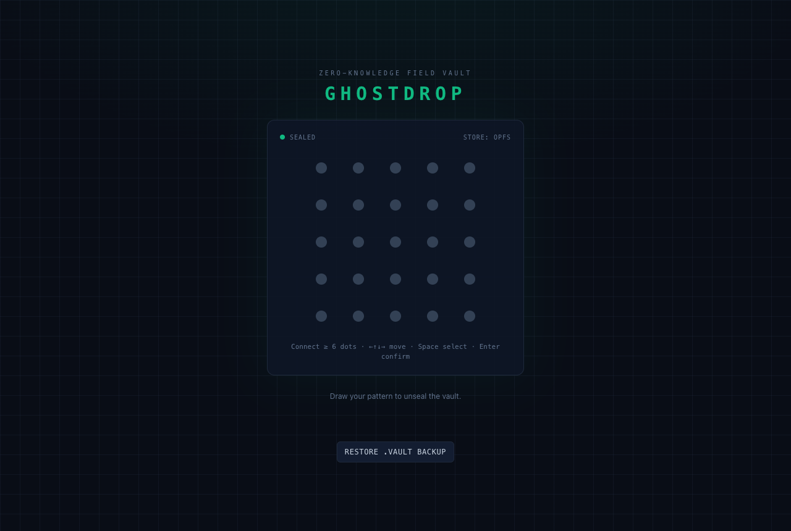
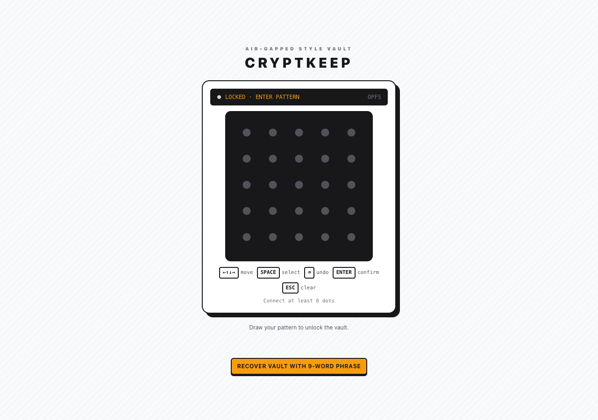
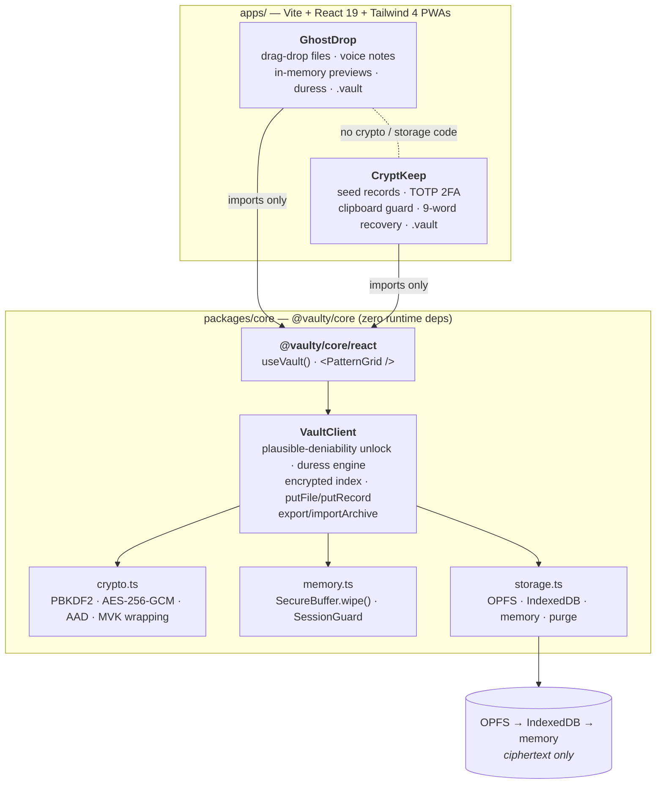

# Vaulty Skeleton

**One zero-knowledge skeleton. Two completely different products.**

`@vaulty/core` is a zero-dependency, client-side vault SDK: draw a 5×5 pattern, get an encrypted vault with
**plausible deniability**, a **forensic-safe duress wipe**, OPFS/IndexedDB storage and **portable encrypted `.vault` archives**.
This repo proves it is a real skeleton by building two apps on it that share *no security code* and almost nothing visually:

| | **GhostDrop** | **CryptKeep** |
|---|---|---|
| For | Journalists & whistleblowers | Crypto holders & 2FA power users |
| Data shape | **Binary** files, photos, PDFs, voice notes | **Structured JSON** seed phrases & TOTP secrets |
| SDK surface | `putFile` / `getFile` · decoy vaults · `configureDuress` · archives | `putRecord<T>` / `getRecord<T>` · 9-word recovery · archives |
| Look | Cyber-noir `#090D16`, emerald, monospace telemetry | Industrial light `#F8FAFC`/`#18181B`, amber `#F59E0B`, hardware-wallet LCDs |
| Signature features | In-browser encrypted voice recorder · zero-leak in-memory previewer · panic wipe | RFC 6238 authenticator with live countdown ring · masked seed words · 15-second clipboard auto-clear |

> Built for **Kiroween — Skeleton Crew**. The `.kiro/` folder (specs, steering, hook) is part of the submission and is fully tracked.

<table>
  <tr>
    <td></td>
    <td></td>
  </tr>
  <tr>
    <td></td>
    <td></td>
  </tr>
  <tr>
    <td></td>
    <td></td>
  </tr>
</table>

<sub>Captured from the production builds in real Chrome by `npm run e2e`.</sub>

---

## Architecture



**The contract, enforced by tests:** each app's `tests/architecture.test.ts` scans its source and fails on any Web Crypto
use (the single exception: HMAC *signing* for RFC 6238 TOTP in CryptKeep), web storage, browser databases, network I/O,
`console`, unexpected imports, or extra runtime dependencies. Both apps depend only on `@vaulty/core`, `react`, `react-dom`.

---

## Security architecture (summary)

| Mechanism | What it does |
|---|---|
| **600,000-iteration PBKDF2-HMAC-SHA256** | Every key-encryption key (pattern, recovery phrase) is derived with a fresh random 16-byte salt through Web Crypto. |
| **Random MVK + key wrapping** | Each vault has a random 256-bit Master Vault Key, never derived from the pattern. It is wrapped (AES-256-GCM, unique 12-byte IV) by the pattern KEK **and** by an independent recovery KEK — so a pattern can change without re-encrypting data. |
| **9-word recovery phrase** | 9 × 11 bits (99 bits) from the embedded BIP-39 list, shown **once**, never stored. Restores a `.vault` archive and lets you choose a new pattern. |
| **AAD binding** | Blobs are bound to *namespace + item id*, the index to the namespace, envelopes to their role — swapping ciphertext between vaults or items fails authentication. |
| **Domain-separated PBKDF2 namespace** | The on-disk folder name is `PBKDF2-HMAC-SHA256("vaulty-ns:v2:"+pattern, public salt, kdfIterations)` — the same cost as attacking the key envelope, instead of a one-round hash an attacker could brute-force from folder names alone. |
| **Plausible deniability** | `unlock()` never says "wrong pattern". An unknown pattern silently opens a fresh, empty vault. Real, decoy and duress vaults are byte-for-byte the same shape on disk. |
| **Forensic-safe duress wipe** | The duress trigger is an *encrypted* flag inside a decoy-looking vault — no plaintext marker anywhere. Entering it wipes the key from memory first, then purges every adapter namespace, OPFS, IndexedDB, Cache API, `localStorage` and `sessionStorage`, then shows an ordinary lock screen. |
| **Memory hygiene** | Keys live in a `SecureBuffer` zero-filled (`fill(0)`) on lock, tab hide, `pagehide`, idle timeout and duress. Apps zero the plaintext buffers they create (file bytes, audio, decrypted previews). |
| **No web storage, no network** | Nothing in `localStorage`/`sessionStorage`/cookies; user data never leaves the device. Production builds ship a strict CSP (`default-src 'self'`, no `unsafe-eval`, no remote origins). |
| **Static guard** | `npm run check:security` (and a Kiro save-hook) rejects `Math.random`, weak ciphers, `exportKey`, extractable keys, literal IVs, `console`, `eval`, network calls in the SDK. |

Full detail: [`.kiro/specs/vaulty-core/design.md`](.kiro/specs/vaulty-core/design.md) (byte-level layouts, threat model) and
[`.kiro/specs/showcase-apps/design.md`](.kiro/specs/showcase-apps/design.md).

### Honest limitations

We would rather you hear these from us:

- **Patterns are low-entropy.** Six ordered nodes ≈ 2²⁷ possibilities. 600k PBKDF2 makes offline guessing expensive, not impossible. The 99-bit recovery phrase is the strong secret.
- **The namespace salt is a public constant**, so an attacker can precompute folder names for likely patterns once and reuse them across installs. A per-install salt would fix it but needs a non-secret global file and breaks cross-device addressing — deferred.
- **`kdfIterations` is part of a vault's address.** Changing it means export → import with a new pattern.
- **Silent re-creation can lose data.** Per the deniability spec, a namespace that fails authentication is replaced with a fresh vault. Export `.vault` backups.
- **Recovery needs the `.vault` file.** The phrase alone cannot locate a vault whose pattern you forgot.
- **JS cannot zero strings.** Decrypted seed words, TOTP secrets and file names live in memory while unlocked; `MediaRecorder` chunks are browser-owned. Byte arrays we own are wiped.
- **Whole-file encryption in memory.** `putFile` takes a `Uint8Array`; GhostDrop caps files at 512 MiB. Chunked/streaming AEAD is future core work.
- **Clipboard:** the 15 s overwrite cannot verify the clipboard still holds our secret; OS clipboard history may keep copies.
- **A bystander sees decoys.** A mistyped pattern creates an empty vault and shows a recovery phrase once. The runtime-option duress path is faster than a normal unlock (no KDF); the in-vault duress path is not.
- **Out of scope:** XSS in the host page, malicious extensions, a compromised OS, keyloggers. Browser coverage in our real-browser test is Chrome only.

---

## Build your own zero-knowledge app in 5 minutes

`@vaulty/core` is a workspace package in this monorepo (not yet published to npm).

**1. Create the app workspace**

```bash
mkdir -p apps/my-vault/src && cd apps/my-vault
cat > package.json <<'EOF'
{
  "name": "my-vault", "private": true, "type": "module",
  "scripts": { "dev": "vite", "build": "vite build" },
  "dependencies": { "@vaulty/core": "0.1.0", "react": "19.3.1", "react-dom": "19.3.1" }
}
EOF
cd ../.. && npm install --save-exact --save-dev --workspace my-vault vite@8.3.7 @vitejs/plugin-react@6.3.0 typescript@5.9.3
```

**2. Unlock with a pattern and store encrypted records** — `apps/my-vault/src/App.tsx`

```tsx
import { useState } from 'react';
import { PatternGrid, useVault } from '@vaulty/core/react';

export function App() {
  // OPFS → IndexedDB → memory is chosen automatically; auto-locks when idle or when the tab is hidden.
  const vault = useVault({ idleTimeoutMs: 60_000 });
  const [phrase, setPhrase] = useState<string | null>(null);

  if (!vault.isUnlocked) {
    return (
      <>
        {phrase && <p>Write this down — shown once: <b>{phrase}</b> <button onClick={() => setPhrase(null)}>Done</button></p>}
        <PatternGrid
          size={300}
          nodeColor="#52525B" activeColor="#F59E0B" lineColor="#F59E0B"   // skin it however you like
          onComplete={async (pattern) => {
            const res = await vault.unlock(pattern);           // no "wrong pattern": unknown patterns open an empty vault
            if (res.status === 'unlocked' && res.created) setPhrase(res.recoveryPhrase ?? null);
          }}
        />
      </>
    );
  }

  return (
    <>
      <button onClick={() => vault.putRecord({ text: 'hello' }, { name: 'note', tags: ['note'] })}>Add encrypted note</button>
      <ul>{vault.entries.map((e) => <li key={e.id}>{e.name} · {e.size} B</li>)}</ul>
      <button onClick={async () => saveAs(await vault.exportArchive(), 'my-vault.vault')}>Export .vault</button>
      <button onClick={() => vault.lock()}>Lock</button>
    </>
  );
}

function saveAs(bytes: Uint8Array, name: string) {            // export is already ciphertext — safe to hand to the browser
  const a = document.createElement('a');
  a.href = URL.createObjectURL(new Blob([bytes as BlobPart]));
  a.download = name;
  a.click();
}
```

`vault.putFile(bytes, {name, mimeType})` / `vault.getFile(id)` handle binary data the same way, `vault.getRecord<T>(id)` reads typed JSON back,
and `vault.importArchive(bytes, patternOrPhrase, { newPattern })` restores a backup.

**3. No React? Use the client directly**

```ts
import { VaultClient, createBestStorageAdapter } from '@vaulty/core';

const vault = new VaultClient({ adapter: await createBestStorageAdapter() });
const res = await vault.unlock([0, 1, 2, 3, 4, 9]);             // ≥ 6 distinct nodes, order matters
await vault.putRecord({ secret: 42 }, { name: 'answer' });
vault.lock();                                                     // wipes the key with fill(0)
```

**4. Run it**: add `vite.config.ts` + `index.html` (copy `apps/ghostdrop`'s as a starting point) and `npm run dev --workspace my-vault`.

---

## Run it

```bash
npm install                 # Node ≥ 20.19
npm run dev:ghostdrop       # builds @vaulty/core, then Vite dev server for GhostDrop
npm run dev:cryptkeep       # same for CryptKeep
npm run typecheck           # strict TypeScript across all workspaces
npm run test:all            # core + GhostDrop + CryptKeep
npm run build:all           # core (ESM+CJS+d.ts) and both production PWAs
npm run e2e                 # real-Chrome end-to-end checks (needs Chrome; CHROME_PATH to override)
```

Dev note: the dev server and `vite preview` need a *secure context* for OPFS and Web Crypto — `localhost` qualifies.

```
packages/core/       @vaulty/core — SDK source, tsup build, 205 tests
apps/ghostdrop/      GhostDrop PWA — 38 tests
apps/cryptkeep/      CryptKeep PWA — 90 tests
e2e/                 real-browser verification (puppeteer-core)
scripts/gen-icons.mjs  dependency-free PWA icon generator
docs/screenshots/    images used above
.kiro/               specs, steering, hook (see below)
```

---

## How Kiro was used

| Artifact | Role |
|---|---|
| [`.kiro/specs/vaulty-core/`](.kiro/specs/vaulty-core) | EARS requirements → design (byte layouts, threat model) → completed task list for the SDK |
| [`.kiro/specs/showcase-apps/`](.kiro/specs/showcase-apps) | EARS requirements → design (SDK reuse matrix) → task list for the two apps |
| [`.kiro/steering/crypto-invariants.md`](.kiro/steering/crypto-invariants.md) | Four non-negotiables: no web storage, fresh IV per encryption, `fill(0)` zeroing, no global metadata |
| [`.kiro/steering/app-boundaries.md`](.kiro/steering/app-boundaries.md) | Apps hold no security logic; zero what you own; the lock screen never hints at decoys or duress |
| [`.kiro/hooks/core-security-check.kiro.hook`](.kiro/hooks/core-security-check.kiro.hook) | On every save under `packages/core/src/**/*.ts`: run the static check and review Web Crypto hygiene |

Steering was not decoration — it caught real issues: the invariants shaped the duress purge (only `.clear()` allowed on web storage), and
`app-boundaries` rule 6 made us remove a lock-screen sentence that explained the deniability mechanism to anyone looking over your shoulder.

---

## Verification (measured, not promised)

| Check | Result |
|---|---|
| `npm run typecheck` (strict, `noUncheckedIndexedAccess`) | 0 errors in `packages/core`, `apps/ghostdrop`, `apps/cryptkeep` |
| `npm run test:all` | **333 tests pass** — core 205 · GhostDrop 38 · CryptKeep 90 |
| `@vaulty/core` coverage (v8) | 97.7 % lines · 94.9 % statements · 94.7 % functions · 88.5 % branches (not 100 %: defensive error paths) |
| `npm run build:all` | core ESM + CJS + `.d.ts` (`react` kept external); GhostDrop 292 kB JS (94 kB gzip); CryptKeep 297 kB JS (96 kB gzip) |
| `npm run check:security` | clean (9 SDK source files); the checker itself is tested against every violation class |
| `npm run e2e` | **20/20 real-Chrome checks**: real 600,000-iteration PBKDF2 (≈ 0.8–1.1 s create+unlock), OPFS dump scanned for plaintext (0 matches), CSP + manifest + service worker, fake-microphone voice note, blob-URL revocation, keyboard-only unlock, **real clipboard cleared at 15.1 s**, duress wipe leaving OPFS/IndexedDB/Cache API/localStorage empty, phrase recovery on a fresh profile |
| RFC conformance | TOTP passes RFC 4226 Appendix D and RFC 6238 Appendix B vectors; SHA-256/512 cross-checked against Node's independent HMAC |

---

## License

MIT — see [LICENSE](LICENSE).
