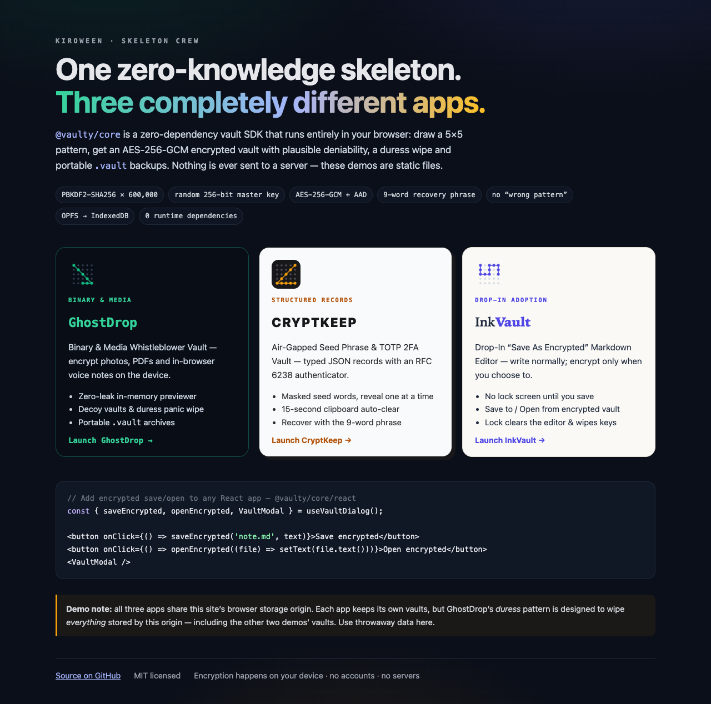
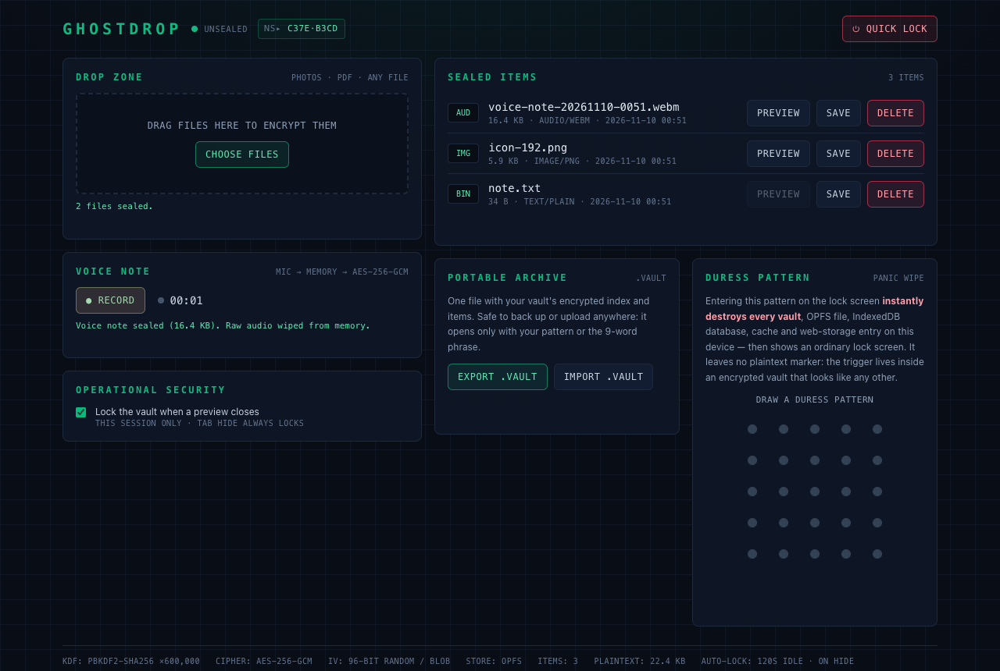
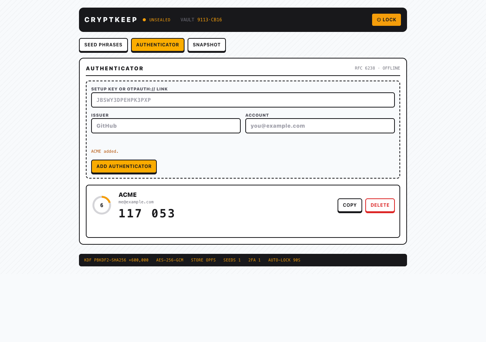
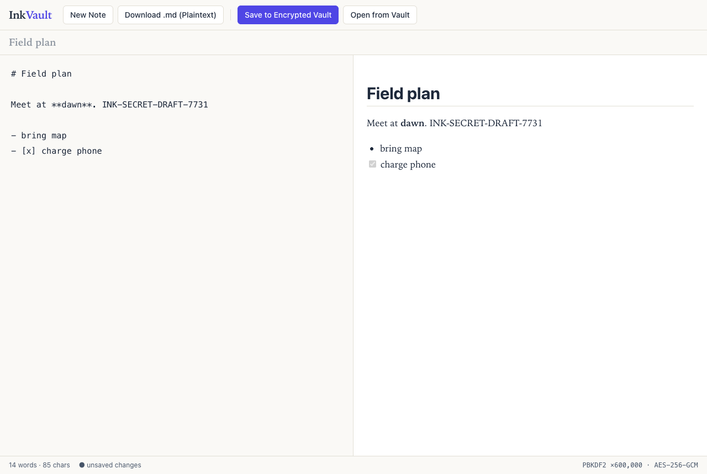
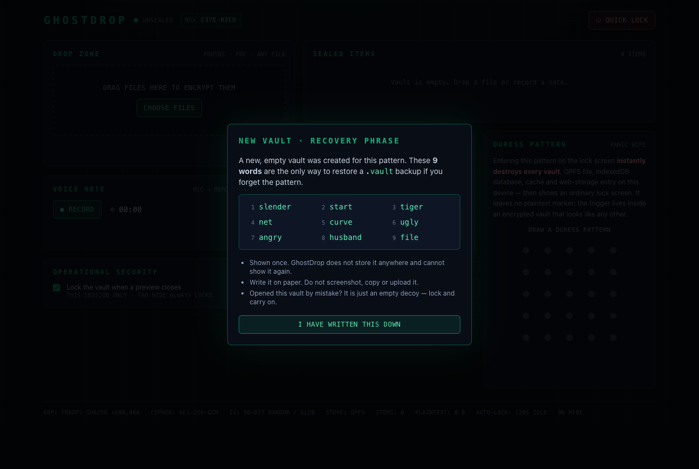
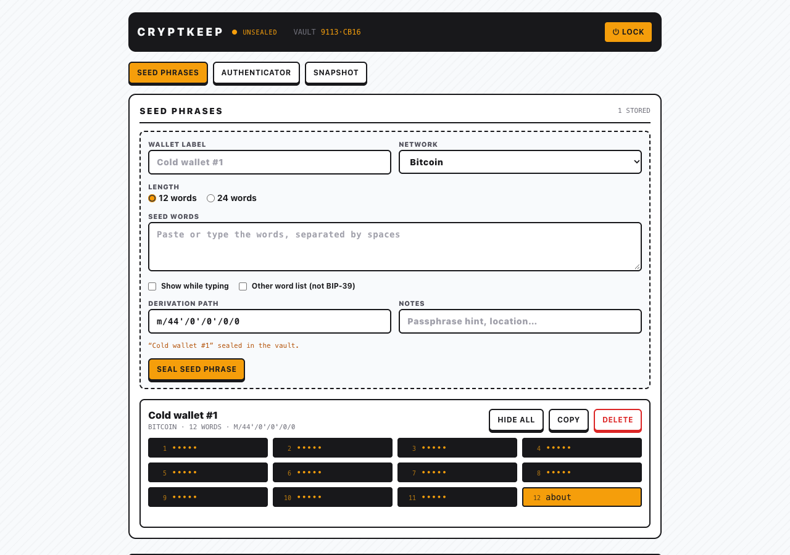
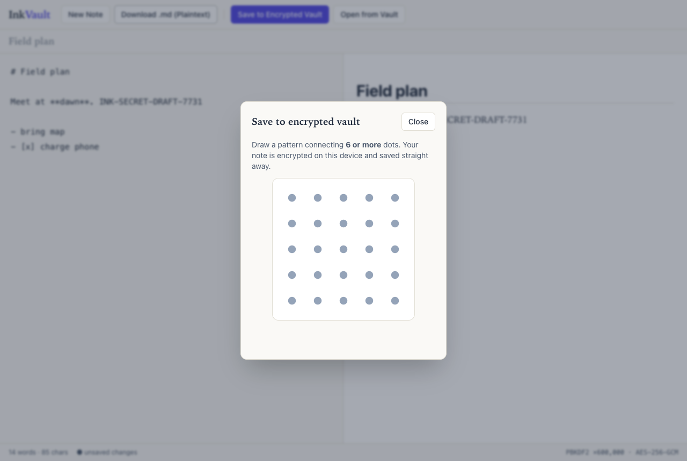
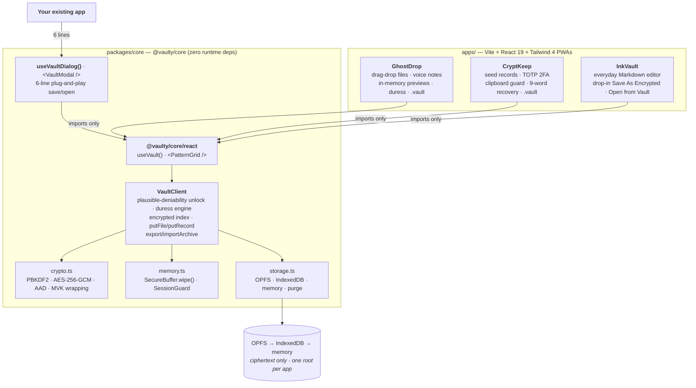
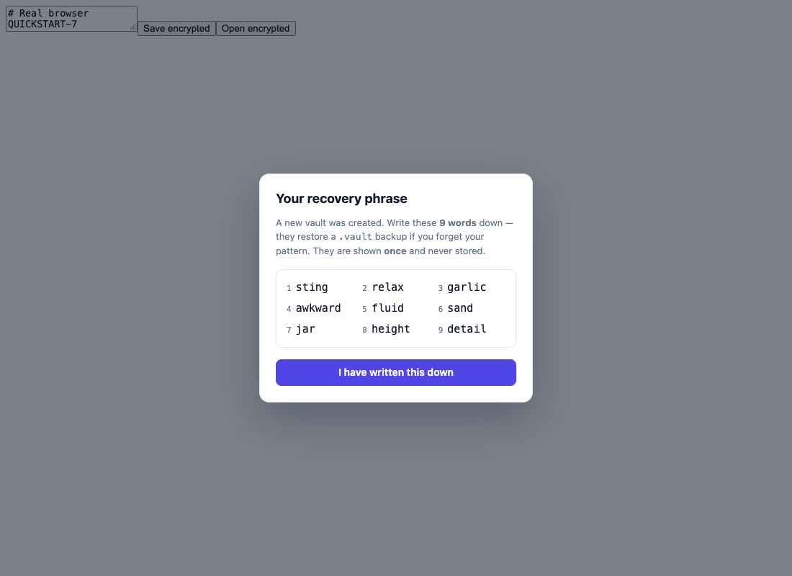
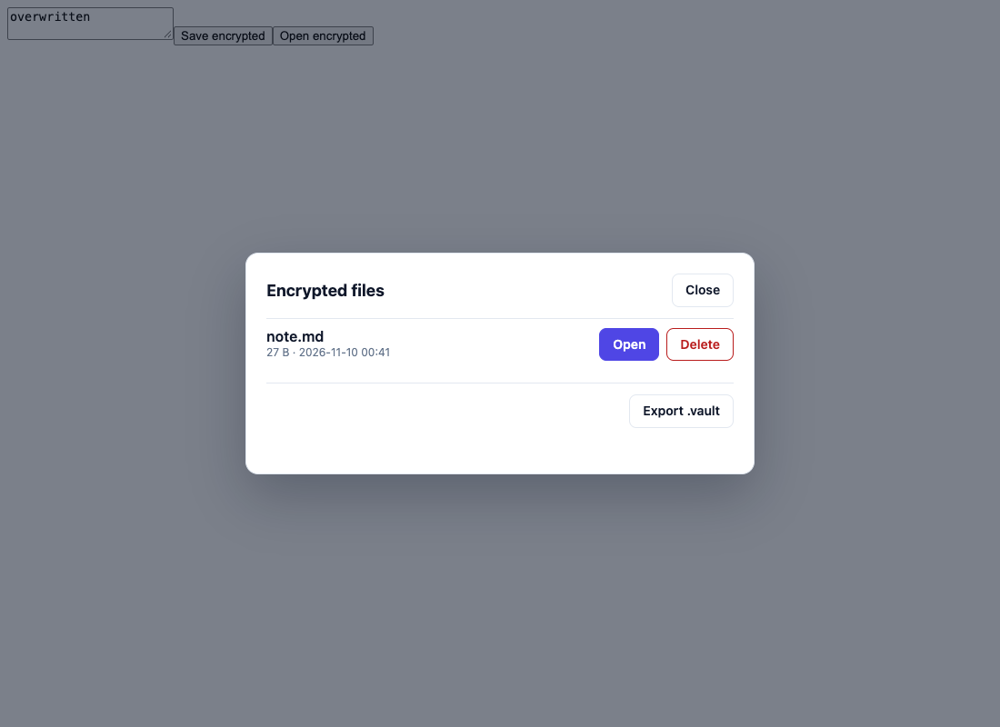

# Vaulty Skeleton

**One zero-knowledge skeleton. Three completely different apps.**

`@vaulty/core` is a zero-dependency, client-side vault SDK: draw a 5×5 pattern, get an encrypted vault with
**plausible deniability**, a **forensic-safe duress wipe**, OPFS/IndexedDB storage and **portable encrypted `.vault` archives**.
This repo proves it is a real skeleton by building three apps on it that share *no security code* and almost nothing visually —
including one that shows how an **existing, ordinary app** adopts encryption without changing how people use it.

## Live demos (GitHub Pages)

| | |
|---|---|
| **Showcase switch page** | **https://isgudtek.github.io/vaulty-skeleton/** |
| GhostDrop — binary & media whistleblower vault | https://isgudtek.github.io/vaulty-skeleton/ghostdrop/ |
| CryptKeep — air-gapped seed phrase & TOTP 2FA vault | https://isgudtek.github.io/vaulty-skeleton/cryptkeep/ |
| InkVault — drop-in "Save As Encrypted" Markdown editor | https://isgudtek.github.io/vaulty-skeleton/inkvault/ |

Deployed by [`.github/workflows/deploy-pages.yml`](.github/workflows/deploy-pages.yml) on every push to `main`. The demos are static
files: nothing you type or draw is sent anywhere.

> **Demo caveat:** the three apps share one browser origin (`isgudtek.github.io`). Each keeps its vaults in its own storage root,
> but GhostDrop's **duress** pattern is designed to wipe *everything* the origin stores — including the other two demos' vaults
> (and any other `isgudtek.github.io` project site's browser data). Use throwaway data on the demo site.

| | **GhostDrop** | **CryptKeep** | **InkVault** |
|---|---|---|---|
| For | Journalists & whistleblowers | Crypto holders & 2FA power users | Anyone writing notes — and any developer adding encryption to an existing app |
| Data shape | **Binary** files, photos, PDFs, voice notes | **Structured JSON** seed phrases & TOTP secrets | **Plain Markdown** documents |
| How encryption appears | A locked vault you unlock first | A locked vault you unlock first | **Never in the way:** normal editor first; the pattern appears only on *Save to Encrypted Vault* / *Open from Vault* |
| SDK surface | `putFile` / `getFile` · decoy vaults · `configureDuress` · archives | `putRecord<T>` / `getRecord<T>` · 9-word recovery · archives | `putFile` / `getFile` / `listEntries` · lock-clears-buffer |
| Look | Cyber-noir `#090D16`, emerald, monospace telemetry | Industrial light `#F8FAFC`/`#18181B`, amber `#F59E0B`, hardware-wallet LCDs | Editorial paper `#FAF9F6`, ink slate `#1E293B`, indigo `#4F46E5` |
| Signature features | In-browser encrypted voice recorder · zero-leak in-memory previewer · panic wipe | RFC 6238 authenticator with live countdown ring · masked seed words · 15 s clipboard auto-clear | Split-pane live preview · XSS-safe built-in Markdown renderer · Ctrl/⌘+S saves encrypted |

> Built for **Kiroween — Skeleton Crew**. The `.kiro/` folder (specs, steering, hook) is part of the submission and is fully tracked.

<p align="center"></p>

<table>
  <tr>
    <td></td>
    <td></td>
    <td></td>
  </tr>
  <tr>
    <td></td>
    <td></td>
    <td></td>
  </tr>
</table>

<sub>Captured from the production builds in real Chrome by `npm run e2e`.</sub>

---

## Architecture



**The contract, enforced by tests:** each app's `tests/architecture.test.ts` scans its source and fails on any Web Crypto
use (the single exception: HMAC *signing* for RFC 6238 TOTP in CryptKeep), web storage, browser databases, network I/O,
`console`, raw-HTML injection, unexpected imports, or extra runtime dependencies. All three apps depend only on
`@vaulty/core`, `react` and `react-dom` — InkVault even renders Markdown with its own small, XSS-safe parser rather than add a library.

---

## Security architecture (summary)

| Mechanism | What it does |
|---|---|
| **600,000-iteration PBKDF2-HMAC-SHA256** | Every key-encryption key (pattern, recovery phrase) is derived with a fresh random 16-byte salt through Web Crypto. |
| **Random MVK + key wrapping** | Each vault has a random 256-bit Master Vault Key, never derived from the pattern. It is wrapped (AES-256-GCM, unique 12-byte IV) by the pattern KEK **and** by an independent recovery KEK — so a pattern can change without re-encrypting data. |
| **9-word recovery phrase** | 9 × 11 bits (99 bits) from the embedded BIP-39 list, shown **once**, never stored. Restores a `.vault` archive and lets you choose a new pattern. |
| **AAD binding** | Blobs are bound to *namespace + item id*, the index to the namespace, envelopes to their role — swapping ciphertext between vaults or items fails authentication. |
| **Domain-separated PBKDF2 namespace** | The on-disk folder name is `PBKDF2-HMAC-SHA256("vaulty-ns:v2:"+pattern, public salt, kdfIterations)` — the same cost as attacking the key envelope, instead of a one-round hash an attacker could brute-force from folder names alone. |
| **Plausible deniability** | `unlock()` never says "wrong pattern". An unknown pattern silently opens a fresh, empty vault. Real, decoy and duress vaults are byte-for-byte the same shape on disk. |
| **Forensic-safe duress wipe** | The duress trigger is an *encrypted* flag inside a decoy-looking vault — no plaintext marker anywhere. Entering it wipes the key from memory first, then purges every adapter namespace, OPFS, IndexedDB, Cache API, `localStorage` and `sessionStorage`, then shows an ordinary lock screen. |
| **Memory hygiene** | Keys live in a `SecureBuffer` zero-filled (`fill(0)`) on lock, tab hide, `pagehide`, idle timeout and duress. Apps zero the plaintext buffers they create, and drop decrypted UI state on lock (InkVault clears the editor and preview in the same frame). |
| **No web storage, no network** | Nothing in `localStorage`/`sessionStorage`/cookies; user data never leaves the device. Production builds ship a strict CSP (`default-src 'self'`, no `unsafe-eval`, no remote origins). |
| **Static guard** | `npm run check:security` (and a Kiro save-hook on `packages/core/src/**/*.{ts,tsx}`) rejects `Math.random`, weak ciphers, `exportKey`, extractable keys, literal IVs, `console`, `eval`, network calls in the SDK. |

Full detail: [`.kiro/specs/vaulty-core/design.md`](.kiro/specs/vaulty-core/design.md) (byte-level layouts, threat model) and
[`.kiro/specs/showcase-apps/design.md`](.kiro/specs/showcase-apps/design.md).

### Honest limitations

We would rather you hear these from us:

- **Patterns are low-entropy.** Six ordered nodes ≈ 2²⁷ possibilities. 600k PBKDF2 makes offline guessing expensive, not impossible. The 99-bit recovery phrase is the strong secret.
- **The namespace salt is a public constant**, so an attacker can precompute folder names for likely patterns once and reuse them across installs. A per-install salt would fix it but needs a non-secret global file and breaks cross-device addressing — deferred.
- **`kdfIterations` is part of a vault's address.** Changing it means export → import with a new pattern.
- **Silent re-creation can lose data.** Per the deniability spec, a namespace that fails authentication is replaced with a fresh vault. Export `.vault` backups.
- **Recovery needs the `.vault` file.** The phrase alone cannot locate a vault whose pattern you forgot.
- **JS cannot zero strings.** Decrypted seed words, TOTP secrets, Markdown text and file names live in memory while unlocked; `MediaRecorder` chunks are browser-owned. Byte arrays we own are wiped.
- **InkVault drafts are plaintext until you save.** That is the point of "normal mode first": nothing is persisted at all until you choose *Save to Encrypted Vault* (or *Download .md*), and a reload warns before discarding unsaved text.
- **Shared origins share fate.** Apps on one origin keep separate vaults, but the duress purge is origin-wide by design (see the demo caveat above).
- **Whole-file encryption in memory.** `putFile` takes a `Uint8Array`; GhostDrop caps files at 512 MiB. Chunked/streaming AEAD is future core work.
- **Clipboard:** the 15 s overwrite cannot verify the clipboard still holds our secret; OS clipboard history may keep copies.
- **A bystander sees decoys.** A mistyped pattern creates an empty vault and shows a recovery phrase once. The runtime-option duress path is faster than a normal unlock (no KDF); the in-vault duress path is not.
- **Out of scope:** XSS in the host page, malicious extensions, a compromised OS, keyloggers. Our real-browser test runs on Chrome only.

---

## Developer integration

### 6-line plug-and-play: `useVaultDialog()`

Add encrypted **Save** and **Open** to any React app. The modal brings its own pattern grid, one-time recovery-phrase screen,
encrypted file browser (with delete and `.vault` export) and inline styles — no CSS framework needed.

```tsx
import { useVaultDialog } from '@vaulty/core/react';

const { saveEncrypted, openEncrypted, VaultModal } = useVaultDialog();
<button onClick={() => saveEncrypted('note.md', text)}>Save encrypted</button>
<button onClick={() => openEncrypted((file) => setText(file.text()))}>Open encrypted</button>
<VaultModal />
```

<table>
  <tr>
    <td></td>
    <td></td>
  </tr>
</table>

<sub>The built-in `<VaultModal />` on a completely unstyled page — exactly those six lines, driven in real Chrome.</sub>

| API | Behaviour |
|---|---|
| `saveEncrypted(filename, data, mimeType?)` | `data` is a `string` or `Uint8Array` (your array is never modified — the SDK encrypts and wipes its own copy). Locked → pattern grid → for a brand-new vault the **9-word phrase** is confirmed **before** encrypting → `putFile()` → closes. Unlocked → saves immediately. Resolves the stored entry, or `null` if cancelled / locked mid-way. MIME type is inferred from the extension (`.md`, `.txt`, `.json`, `.csv`, `.html`). |
| `openEncrypted(onSelect)` | Locked → pattern grid → file browser (`listEntries()`), with two-step delete and **Export .vault**. Choosing a file decrypts it with `getFile()` and calls `onSelect({ id, name, mimeType, size, bytes, text() })`. Resolves `true` if a file was opened. |
| `lockVault()` · `isUnlocked` · `namespaceId` | Lock now (wipes the key); state for your own UI. |
| `useVaultDialog({ theme, title, ...useVaultOptions })` | Override colours/fonts (`accent`, `background`, `nodeColor`, …) and pass any `useVault` option (`idleTimeoutMs`, `adapter`, `duressPattern`, …). |

Escape cancels (except on the recovery-phrase step, which needs the explicit confirmation). If the vault locks while the
modal is open — idle timeout, hidden tab — the pending save is aborted and nothing is stored.

### More control: `useVault()` + `<PatternGrid />`

This is what the three showcase apps use. `@vaulty/core` is a workspace package in this monorepo (not yet published to npm).

```tsx
import { useState } from 'react';
import { PatternGrid, useVault } from '@vaulty/core/react';

export function App() {
  // OPFS → IndexedDB → memory is chosen automatically; auto-locks when idle or when the tab is hidden.
  const vault = useVault({ idleTimeoutMs: 60_000 });
  const [phrase, setPhrase] = useState<string | null>(null);

  if (!vault.isUnlocked) {
    return (
      <>
        {phrase && <p>Write this down — shown once: <b>{phrase}</b> <button onClick={() => setPhrase(null)}>Done</button></p>}
        <PatternGrid
          size={300}
          nodeColor="#52525B" activeColor="#F59E0B" lineColor="#F59E0B"   // skin it however you like
          onComplete={async (pattern) => {
            const res = await vault.unlock(pattern);           // no "wrong pattern": unknown patterns open an empty vault
            if (res.status === 'unlocked' && res.created) setPhrase(res.recoveryPhrase ?? null);
          }}
        />
      </>
    );
  }

  return (
    <>
      <button onClick={() => vault.putRecord({ text: 'hello' }, { name: 'note', tags: ['note'] })}>Add encrypted note</button>
      <ul>{vault.entries.map((e) => <li key={e.id}>{e.name} · {e.size} B</li>)}</ul>
      <button onClick={async () => saveAs(await vault.exportArchive(), 'my-vault.vault')}>Export .vault</button>
      <button onClick={() => vault.lock()}>Lock</button>
    </>
  );
}

function saveAs(bytes: Uint8Array, name: string) {            // export is already ciphertext — safe to hand to the browser
  const a = document.createElement('a');
  a.href = URL.createObjectURL(new Blob([bytes as BlobPart]));
  a.download = name;
  a.click();
}
```

`vault.putFile(bytes, {name, mimeType})` / `vault.getFile(id)` handle binary data, `vault.getRecord<T>(id)` reads typed JSON back,
and `vault.importArchive(bytes, patternOrPhrase, { newPattern })` restores a backup.

### No React? Use the client directly

```ts
import { VaultClient, createBestStorageAdapter } from '@vaulty/core';

const vault = new VaultClient({ adapter: await createBestStorageAdapter({ rootName: 'my-app' }) });
const res = await vault.unlock([0, 1, 2, 3, 4, 9]);             // ≥ 6 distinct nodes, order matters
await vault.putRecord({ secret: 42 }, { name: 'answer' });
vault.lock();                                                     // wipes the key with fill(0)
```

Give each app its own `rootName` (and `dbName`) if several share an origin, as the showcase apps do on GitHub Pages.

### Start a new app workspace

```bash
mkdir -p apps/my-vault/src && cd apps/my-vault
cat > package.json <<'EOF'
{
  "name": "my-vault", "private": true, "type": "module",
  "scripts": { "dev": "vite", "build": "vite build" },
  "dependencies": { "@vaulty/core": "0.1.0", "react": "19.3.1", "react-dom": "19.3.1" }
}
EOF
cd ../.. && npm install --save-exact --save-dev --workspace my-vault vite@8.3.7 @vitejs/plugin-react@6.3.0 typescript@5.9.3
```

Then add `vite.config.ts` + `index.html` (copy `apps/inkvault`'s as a starting point) and `npm run dev --workspace my-vault`.

---

## Run it

```bash
npm install                 # Node ≥ 20.19
npm run dev:ghostdrop       # builds @vaulty/core, then Vite dev server → http://localhost:5181
npm run dev:cryptkeep       # same for CryptKeep                        → http://localhost:5182
npm run dev:inkvault        # same for InkVault                         → http://localhost:5183
npm run typecheck           # strict TypeScript across all workspaces
npm run check:security      # static Web Crypto / storage hygiene check of the SDK
npm run test:all            # core + GhostDrop + CryptKeep + InkVault
npm run build:all           # core (ESM+CJS+d.ts) and the three production PWAs
npm run e2e                 # real-Chrome end-to-end checks (needs Chrome; CHROME_PATH to override)
```

Sub-path hosting: `VITE_BASE_PATH=/some/path/ npm run build --workspace inkvault` (all three apps honour it; the Pages workflow uses it).
The dev server and `vite preview` need a *secure context* for OPFS and Web Crypto — `localhost` qualifies.

```
packages/core/          @vaulty/core — SDK source, tsup build, 220 tests
apps/ghostdrop/         GhostDrop PWA — 40 tests
apps/cryptkeep/         CryptKeep PWA — 92 tests
apps/inkvault/          InkVault PWA — 74 tests
site/index.html         GitHub Pages switch landing page
.github/workflows/      deploy-pages.yml
e2e/                    real-browser verification (puppeteer-core)
scripts/gen-icons.mjs   dependency-free PWA icon generator
docs/screenshots/       images used above
.kiro/                  specs, steering, hook (see below)
```

---

## How Kiro was used

| Artifact | Role |
|---|---|
| [`.kiro/specs/vaulty-core/`](.kiro/specs/vaulty-core) | EARS requirements → design (byte layouts, threat model) → completed task list for the SDK |
| [`.kiro/specs/showcase-apps/`](.kiro/specs/showcase-apps) | EARS requirements → design (SDK reuse matrix) → task list for the three apps, `useVaultDialog` and Pages |
| [`.kiro/steering/crypto-invariants.md`](.kiro/steering/crypto-invariants.md) | Four non-negotiables: no web storage, fresh IV per encryption, `fill(0)` zeroing, no global metadata |
| [`.kiro/steering/app-boundaries.md`](.kiro/steering/app-boundaries.md) | Apps hold no security logic; zero what you own; the lock screen never hints at decoys or duress |
| [`.kiro/hooks/core-security-check.kiro.hook`](.kiro/hooks/core-security-check.kiro.hook) | On every save under `packages/core/src/**/*.{ts,tsx}`: run the static check and review Web Crypto hygiene |

Steering was not decoration — it caught real issues: the invariants shaped the duress purge (only `.clear()` allowed on web storage),
`app-boundaries` rule 6 made us remove a lock-screen sentence that explained the deniability mechanism to anyone looking over your
shoulder, and the "verify in a real browser" rule surfaced an InkVault bug the unit tests could not see: the decrypted note lingered in
the deferred-render preview for a few frames after *Lock Vault*.

---

## Verification (measured, not promised)

| Check | Result |
|---|---|
| `npm run typecheck` (strict, `noUncheckedIndexedAccess`) | 0 errors in `packages/core` and all three apps |
| `npm run test:all` | **426 tests pass** — core 220 · GhostDrop 40 · CryptKeep 92 · InkVault 74 |
| `@vaulty/core` coverage (v8) | 97.8 % lines · 95.2 % statements · 95.5 % functions · 89.1 % branches (not 100 %: defensive error paths) |
| `npm run build:all` | core ESM + CJS + `.d.ts` (`react` and `react/jsx-runtime` kept external); GhostDrop 292 kB JS (94 kB gzip) · CryptKeep 297 kB (96 kB) · InkVault 284 kB (93 kB) |
| `npm run check:security` | clean (11 SDK source files, including the new `dialog.tsx`); the checker itself is tested against every violation class |
| `npm run e2e` | **29/29 real-Chrome checks**: real 600,000-iteration PBKDF2 (≈ 0.7–1.1 s create+unlock), OPFS dumps scanned for plaintext (0 matches), CSP + manifest + service worker, fake-microphone voice note, blob-URL revocation, keyboard-only unlock, **real clipboard cleared at 15.1 s**, duress wipe leaving OPFS/IndexedDB/Cache API/localStorage empty, phrase recovery on a fresh profile, InkVault save → lock → open with the preview empty on the first frame after lock, and a `VITE_BASE_PATH` sub-path build with no 404s |
| GitHub Pages simulation | the workflow's own build steps, served under `/vaulty-skeleton/`: switch page cards, each app's assets and service-worker scope under its sub-path, and per-app storage roots verified in Chrome |
| RFC conformance | TOTP passes RFC 4226 Appendix D and RFC 6238 Appendix B vectors; SHA-256/512 cross-checked against Node's independent HMAC |
| Mutation checks | InkVault's lifecycle tests fail when the editor or recovery phrase is not cleared on lock, or a draft is written to `localStorage` |

---

## License

MIT — see [LICENSE](LICENSE).
